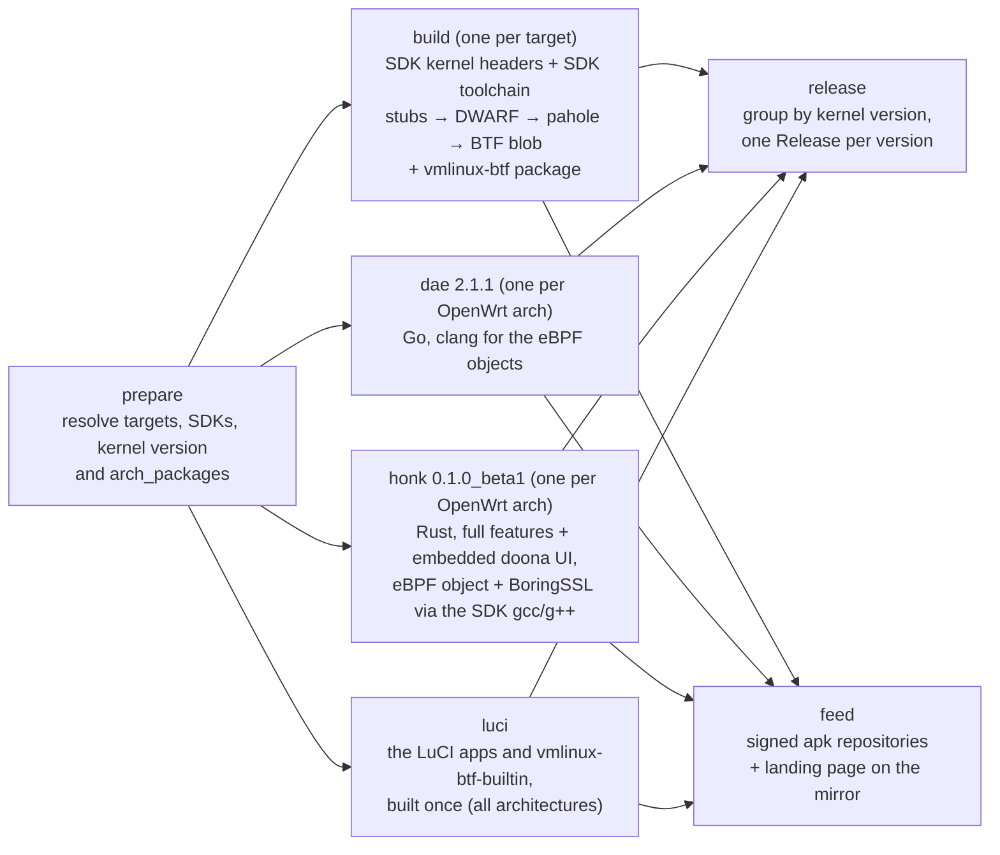

# openwrt-packages

Builds a BTF-enabled `vmlinux` and the `vmlinux-btf` package for every OpenWrt
target of the [supported architectures](#architectures), and the `dae` and
`honk` packages for those architectures, then publishes everything in a single
GitHub Release per kernel version. The same packages, plus LuCI
apps for dae and honk, are published as a signed apk
[package feed](#package-feed) at <https://openwrt.daeuniverse.org/>.

The BTF is produced the way the OpenWrt package
[QiuSimons/vmlinux-btf](https://github.com/QiuSimons/vmlinux-btf) does it: a few
small stub sources (`src/shadow_btf_*.c`, vendored from that repository) include
the key kernel headers, the target compiler emits their DWARF, and `pahole`
converts that into the detached BTF blob. Everything comes from the **official
OpenWrt SDK** of each target — its prepared kernel headers and its cross
toolchain — so neither an OpenWrt buildroot nor a kernel configuration or build
is involved, and the types are exactly those of the kernel OpenWrt ships for
that target, patches included.

The packages around it are ordinary OpenWrt packages: the repository root
doubles as an [OpenWrt feed](#repository-layout), with `vmlinux-btf/`, `dae/` and
`honk/` next to the BTF sources, so the released assets are real `.apk` packages
that can be installed with `apk add`.

Everything happens in a single workflow,
[`.github/workflows/build-vmlinux-btf.yml`](.github/workflows/build-vmlinux-btf.yml),
which is documented below. See [Provenance](#provenance) for where each part
comes from.

---

## Repository layout

```
.
├── .github/workflows/build-vmlinux-btf.yml  # the only workflow
├── vmlinux-btf/  # OpenWrt package "vmlinux-btf": Makefile (prebuilt blob)
├── vmlinux-btf-builtin/  # OpenWrt package "vmlinux-btf-builtin": Makefile (empty)
├── dae/          # OpenWrt package "dae":  Makefile + build.sh + files/ (init, UCI)
├── honk/         # OpenWrt package "honk": Makefile + build.sh + files/ (init, UCI, config)
├── luci-lib-daeuniverse/  # the LuCI page shared by both apps, and its translations
├── luci-app-dae/          # LuCI app for dae: menu entry, ACL, the page's settings
├── luci-app-honk/         # LuCI app for honk: the same for honk
├── keys/         # public-key.pem: the key the .apk packages are signed with
├── scripts/      # setup-signing-key.sh: restores and checks the signing key
                  # sign-packages.sh: signs the built .apk files and verifies them
                  # fetch-openwrt-sdk.sh: downloads the SDK, official host then mirror
                  # feed-site/: writes the landing page of the package feed
├── docs/screenshots/  # the LuCI screenshots of this README
└── src/          # vendored BTF stubs from QiuSimons/vmlinux-btf
```

The repository root is an OpenWrt feed. The workflow writes
`src-link local <workspace>` into the SDK's `feeds.conf`, installs the packages
from it and builds them with `make package/<name>/compile`, which is what turns
them into `.apk` packages. `vmlinux-btf` is special: the workflow hands the BTF
blob it just produced to the package as `VMLINUX_BTF_SRC`, so the package only
installs it and the archive and the package hold identical bytes.
The upstream sources are checked out into `dae/src` and `honk/src` (they are not
committed), so the directories can also be copied into an OpenWrt buildroot,
or used against a manually unpacked SDK:

```sh
git clone --recurse-submodules --branch v2.1.1 https://github.com/daeuniverse/dae dae/src
git clone --branch v0.1.0-beta.1 https://github.com/daeuniverse/honk honk/src
```

`./scripts/feeds install dae` (or `honk`) also installs `vmlinux-btf`, which
both depend on, and `make package/dae/compile` builds it first. It needs the
blob as `VMLINUX_BTF_SRC`; without one, pass `CONFIG_PACKAGE_vmlinux-btf=` on
the `make` command line, as the dae, honk and LuCI jobs do. For a kernel with
its own BTF, select `vmlinux-btf-builtin` instead, which keeps `vmlinux-btf`
out.

## What it produces

| Asset | Contents | Built from |
|---|---|---|
| `<openwrt_version>-vmlinux-<target>-<subtarget>-<kernel_version>.tar.xz` | one file named `vmlinux`: the detached BTF blob (the same file the upstream package installs) | `src/shadow_btf_*.c` compiled against the SDK's prepared kernel headers with the SDK toolchain, then `pahole` |
| `<openwrt_version>-vmlinux-btf-<target>-<subtarget>-<kernel_version>.apk` | OpenWrt package `vmlinux-btf` (version = kernel version), installing `/usr/lib/debug/boot/vmlinux`, the `vmlinux-<kernel release>` symlink and `/usr/share/vmlinux-btf/version`; it only installs on the exact kernel it was built for | the same blob, packaged with [`vmlinux-btf/Makefile`](vmlinux-btf/Makefile) |
| `vmlinux-btf-builtin-<version>.apk` | OpenWrt package `vmlinux-btf-builtin`, empty and architecture independent: provides `vmlinux-btf` on a kernel with its own BTF (ImmortalWrt), where `vmlinux-btf` does not install | [`vmlinux-btf-builtin/Makefile`](vmlinux-btf-builtin/Makefile) |
| `<openwrt_version>-dae-2.1.1-<openwrt_arch>.apk` | OpenWrt package `dae` 2.1.1, installing `/usr/bin/dae`, a procd init script and `/etc/config/dae` | [daeuniverse/dae](https://github.com/daeuniverse/dae) tag `v2.1.1`, built by [`dae/Makefile`](dae/Makefile) |
| `<openwrt_version>-honk-0.1.0_beta1-<openwrt_arch>.apk` | OpenWrt package `honk` 0.1.0_beta1, installing `/usr/bin/honk-core` (full feature set with the embedded doona UI), a procd init script and `/etc/config/honk` | [daeuniverse/honk](https://github.com/daeuniverse/honk) tag `v0.1.0-beta.1`, built by [`honk/Makefile`](honk/Makefile) |
| `public-key.pem` | the public key that verifies the signature of every `.apk` asset of the release | [`keys/public-key.pem`](keys/public-key.pem), see [Verifying the packages](#verifying-the-packages) |

Both userspace packages are OpenWrt services: they install
`/etc/init.d/<name>`, `/etc/config/<name>` and a default configuration
(`/etc/dae/config.dae` from the upstream example, `/etc/honk/config.dae` from
[`honk/files/config.dae`](honk/files/config.dae)). The service stays disabled
until `option enabled '1'` is set; see [OpenWrt integration](#openwrt-integration).

Every archive and package is uploaded together with its `.sha256` checksum.
The `dae` and
`honk` packages are built once per OpenWrt architecture and are pinned to an
upstream release, so their name carries that version and not the kernel version;
`x86_64` gets `25.12.6-dae-2.1.1-x86_64.apk` while `aarch64_cortex-a76` gets
`25.12.6-honk-0.1.0_beta1-aarch64_cortex-a76.apk`. OpenWrt 25.x produces
`.apk` packages. The workflow signs those packages and publishes only the
signed `.apk` files. Older `.ipk` output is not supported and fails the build.

The version also flows into the binaries: it is passed to the package Makefiles
as `DAE_VERSION` / `HONK_VERSION`, dae's own make receives it as `VERSION`, and
honk derives the string it embeds from `GITHUB_REF`, so a
`refs/tags/v0.1.0-beta.1` ref is exported for its build (the build script then
asserts that the tag, not the git fallback, is what ended up in the binary).
`0.1.0-beta.1` is not a valid apk version — `~` there introduces a commit hash
— so the package spells the beta pre-release as `0.1.0_beta1`, while the sources
and the embedded version come from the upstream tag `v0.1.0-beta.1` itself.

## Usage

1. Go to **Actions → Build vmlinux (BTF) → Run workflow**.
2. Fill in the inputs:

| Input | Default | Meaning |
|---|---|---|
| `openwrt_version` | `25.12.6` | OpenWrt release to build for, e.g. `25.12.6`. The kernel version is taken from that release, not entered by hand. Only apk releases (25.12 and later) build. |
| `upload_release` | on | Publish the GitHub Releases. |
| `upload_feed` | on | Upload the [package feed](#package-feed) to the mirror. |

With both uploads off a run only builds, which tests a branch without
publishing anything.

3. The result appears under **Releases**, tagged
   `openwrt-<openwrt_version>-<kernel_version>-<date>` — for example
   `openwrt-25.12.6-6.12.112-20261024`. `<date>` is the UTC date of the run, the
   same for every kernel version it publishes. All targets of one kernel
   version are collected in that single release; re-running the workflow
   overwrites the existing assets instead of failing, and an existing
   tag/release is reused (a second run on the same UTC day publishes into that
   day's release). The asset names themselves do not carry the date.
   The `dae`/`honk` assets are kernel independent, so every release published by
   a run carries the same set of them (all five architectures), while each
   `vmlinux-btf` package sits in the release of its kernel version.

On a device, the BTF blob is normally installed where libbpf and `bpftool`
expect it, `/usr/lib/debug/boot/vmlinux`. The `vmlinux-btf` package does exactly
that (including the `vmlinux-<kernel release>` symlink the upstream package
creates), so the archive can be skipped entirely:

```sh
# public-key.pem from the same release; the file name on the device does not
# matter, apk matches the key itself rather than the file name
cp public-key.pem /etc/apk/keys/

apk add 25.12.6-vmlinux-btf-bcm27xx-bcm2712-6.12.112.apk
```

The package records the kernel version it was built for in
`/usr/share/vmlinux-btf/version` and depends on the exact `kernel` package of
the SDK (version, vermagic and release, the way kmods are locked), so apk
refuses it on any other kernel — another point release, another target or a
self-built kernel — instead of installing a blob whose CO-RE relocations would
resolve the wrong types. The symlink it ships is therefore always the one
`uname -r` names.

dae and honk depend on `vmlinux-btf`. On a kernel with its own BTF
(`/sys/kernel/btf/vmlinux`, e.g. ImmortalWrt), where `vmlinux-btf` does not
install, the empty `vmlinux-btf-builtin` satisfies the dependency: it provides
`vmlinux-btf` with a priority, and apk takes the real package wherever it
installs, and `apk upgrade vmlinux-btf-builtin` replaces this one with it once
the real one becomes available. Its pre-install check reports a kernel without
BTF (the kmods repository is missing) with that command; apk does not stop at a failed check,
so the init scripts check again and log the same.

The `dae` and `honk` assets are OpenWrt packages as well:

```sh
apk add 25.12.6-dae-2.1.1-aarch64_cortex-a76.apk
apk add 25.12.6-honk-0.1.0_beta1-aarch64_cortex-a76.apk
```

The packages are signed after the SDK build, so `apk` accepts them once
`public-key.pem` is in `/etc/apk/keys/`; without the key it rejects them (see
[Verifying the packages](#verifying-the-packages)). The
userspace packages install `/usr/bin/dae` and `/usr/bin/honk-core`, a procd init
script, a UCI configuration and a default configuration file. Both depend on
`v2ray-geoip` and `v2ray-geosite` (from the OpenWrt packages feed) and symlink
`/usr/share/v2ray/geoip.dat` and `geosite.dat` into `/usr/share/dae` and
`/usr/share/honk`, which is where each program looks them up. `honk` also
declares `libstdcpp` and the kernel modules its datapath needs, so `apk` pulls
those in automatically.

## Verifying the packages

The `.apk` assets are signed. `public-key.pem` is the matching public key; it is
committed as [`keys/public-key.pem`](keys/public-key.pem) and attached to every
release, so take it from whichever is convenient:

```sh
# from the newest release, or from the repository at the same tag/commit
curl -LO https://github.com/daeuniverse/openwrt-packages/releases/latest/download/public-key.pem
curl -LO https://raw.githubusercontent.com/daeuniverse/openwrt-packages/main/keys/public-key.pem
```

Copy it into the trust store and install as usual - no `--allow-untrusted`
needed:

```sh
cp public-key.pem /etc/apk/keys/
apk add 25.12.6-vmlinux-btf-bcm27xx-bcm2712-6.12.112.apk
```

The file name in `/etc/apk/keys/` does not matter: apk identifies a key by its
content rather than by the name, and it tries every key it finds there, so this
one lives next to OpenWrt's own key without replacing it. Without the key apk
rejects the packages as untrusted.

The `.tar.xz` archives are not packages and are not signed. Compare their
published `.sha256` checksums instead. The workflow does not build or publish
`.ipk` packages.

## OpenWrt integration

Both packages are ordinary OpenWrt services and are disabled after installation.
The init scripts are [`dae/files/dae.init`](dae/files/dae.init) and
[`honk/files/honk.init`](honk/files/honk.init); their UCI files are
`/etc/config/dae` and `/etc/config/honk`:

```sh
# /etc/config/dae or /etc/config/honk
config dae 'config'            # config honk 'config'
	option enabled '0'
	option config_file '/etc/dae/config.dae'   # or /etc/honk/config.dae

/etc/init.d/dae enable && /etc/init.d/dae start
/etc/init.d/honk enable && /etc/init.d/honk start
```

The scripts follow the usual procd conventions:

* `start_service` does nothing while `enabled` is `0`.
* dae and honk are never on at the same time: both create the `dae0` link
  pair and the `daens` namespace and hook the same interfaces. Turning one on
  in LuCI also turns the other off in the same Save & Apply, so switching is
  one step. The init scripts only follow their own `enabled`: with both turned
  on by hand, the one started second refuses and logs why.
* `dae` runs `dae validate -c <config_file>` before every start; a
  configuration that fails the rule pipeline (including missing geo assets) is
  logged and dae is not started. That includes the restart for a changed
  `config_file`, which stops the instance running the old one.
* `reload` follows the UCI settings: it stops a service that was turned off,
  starts one that was turned on and restarts one whose `config_file` changed.
  Otherwise a running dae receives `SIGUSR1` (what `dae reload` sends; dae
  ignores `SIGHUP`) and a running honk `honk-core reload`, so established
  connections survive a configuration change. Both services
  respawn after a crash, and stdout/stderr are forwarded to syslog (`logread`),
  so no log file rotation is needed.
* The honk script mounts `bpffs` on `/sys/fs/bpf` when it is not mounted yet,
  because aya pins its maps there and OpenWrt does not mount it by itself.

Kernel modules are declared as package dependencies:

| Package | Why |
|---|---|
| `kmod-sched-core`, `kmod-sched-bpf`, `kmod-veth` | TC-bpf datapath and `dae0` veth pair of dae |
| `kmod-veth`, `kmod-sched-core`, `kmod-sched-bpf` | the same TC datapath and `dae0` link pair for honk |
| `kmod-nft-core`, `kmod-nft-queue`, `kmod-nfnetlink-queue`, `kmod-nf-conntrack` | honk's NFQUEUE staging for ambiguous LAN UDP first packets |

Both eBPF engines need BTF, so both depend on `vmlinux-btf` (see above). dae
reads `/usr/lib/debug/boot/vmlinux-<kernel release>` when sysfs has no
`vmlinux`, honk `/usr/lib/debug/boot/vmlinux`. dae needs Linux 5.17 or newer
and honk 6.12 or newer; OpenWrt 25.12 runs 6.12.

### honk's embedded UI

The honk package is built with the full feature set — the crate defaults
(`clash-api`, `mimalloc`, `rprx`) plus `ebpf` and `native-ui` — so the pinned
doona dashboard is embedded in `/usr/bin/honk-core`. Doona is downloaded as a
release archive at build time (SHA-256 verified against honk's
`.github/ci/pins.env`); the frontend is never compiled here.

The shipped `/etc/honk/config.dae` enables it on loopback:

```dae
experimental {
    native_api {
        enabled: true
        listen: '127.0.0.1:9527'
        allow_anonymous_loopback: true
        ui: 'embedded'
    }
}
```

Reach it through SSH port forwarding (`ssh -L 9527:127.0.0.1:9527 root@router`)
and open `http://127.0.0.1:9527/`. Anonymous loopback access is for local setup;
replace it with `secret: '<long random token>'` (and terminate TLS at a reverse
proxy) before exposing the API on any other interface. honk keeps runtime state
in `global.data_dir` (`/var/lib/honk` by default); on OpenWrt `/var` is a tmpfs,
so Selector choices and subscription caches do not survive a reboot — point
`data_dir` at persistent storage if that matters.

## LuCI apps

`luci-app-dae` and `luci-app-honk` add **Services → dae** and **Services →
honk**. Both are thin settings on one shared page from `luci-lib-daeuniverse`,
which has three tabs:

* **Service status** — whether the service runs, the enabled switch and the
  configuration file (a file under `/etc/dae` or `/etc/honk`, the only
  directories the page may read and write). Saving and applying hands the
  switch to the init script, which starts or stops the service; turning one
  service on turns the other off, as the page notes next to the switch.
* **Configuration** — an editor with syntax highlighting for the main
  configuration file and every file it pulls in with `include`; each tab saves
  to its own file. While the service is turned on, saving reloads it (dae
  validates the configuration first), which also starts a stopped one.
* **Log** — the service's lines from `logread`.

The page is built from LuCI's own widgets, so it follows every official theme,
light or dark; only the syntax colours of the editor are its own, mid tones
that read on both. Translations are in `luci-i18n-daeuniverse-zh-cn` and
`-zh-tw`. Besides its app's ACL, a non-root LuCI user needs `luci-base` for the
UCI calls.

| Service status | Configuration | Log |
|---|---|---|
|  |  |  |

The LuCI packages are architecture independent and only published in the
package feed, not in the GitHub Releases.

## Package feed

<https://openwrt.daeuniverse.org/> serves every package as a signed apk
repository, with a landing page (English, Simplified and Traditional Chinese)
that walks through the setup. The layout:

```
<series>/packages/<openwrt_arch>/                       dae, honk, the LuCI apps, vmlinux-btf-builtin
<series>/kmods/<release>/<target>/<subtarget>/          vmlinux-btf
public-key.pem                                          key of every packages.adb
```

`<series>` is `25.12`: one packages directory serves every point release of
the series, on OpenWrt and on ImmortalWrt, while `vmlinux-btf` is published per
release and target because it only installs on that exact kernel. A device adds
the repositories with the `@daeuniverse` tag, so a package the system also has
is only taken from the feed when it is named with the tag
(`apk add dae@daeuniverse`), and the feed never replaces a system package of
the same name — ImmortalWrt ships its own `dae` and `luci-app-dae`:

```sh
wget -O /etc/apk/keys/daeuniverse.pem https://openwrt.daeuniverse.org/public-key.pem
. /etc/openwrt_release
FEED=https://openwrt.daeuniverse.org/$(echo "$DISTRIB_RELEASE" | cut -d. -f1-2)
cat > /etc/apk/repositories.d/daeuniverse.list <<EOF
@daeuniverse $FEED/packages/$DISTRIB_ARCH/packages.adb
@daeuniverse $FEED/kmods/$DISTRIB_RELEASE/$DISTRIB_TARGET/packages.adb
EOF
apk update
apk add dae@daeuniverse luci-app-dae@daeuniverse
```

(or `honk` and `luci-app-honk`). ImmortalWrt leaves out the `kmods` line.
A dependency the system also has comes from the system unless it is named with
the tag, so the service is named too: ImmortalWrt would otherwise install its
own, older `dae` for `luci-app-dae`. `vmlinux-btf` comes along: from the kmods
repository on official OpenWrt, as `vmlinux-btf-builtin` on ImmortalWrt.
Supported versions:

| Version | Kernel | Status |
|---|---|---|
| 25.12 | 6.12 | Supported on OpenWrt and ImmortalWrt. |
| 24.10 | 6.6 | Not supported: opkg has no repository tags, so the feed would replace packages of the same name, and ImmortalWrt 24.10 ships its own dae. The kernel is older than honk needs. |
| 23.05 and older | ≤ 5.15 | Not supported: the kernel is older than dae and honk need. |

dae needs kernel 5.17 or later, honk 6.12 or later.

The packages are built for the [architectures](#architectures) below. On
official OpenWrt, dae and honk also need the `vmlinux-btf` of the device's
target, which is built for every target of those architectures; ImmortalWrt
only needs the architecture to match. 32-bit ARM and MIPS are not supported on
either.

Mirroring: `rsync://openwrt.daeuniverse.org/openwrt-daeuniverse/`, see
`<lang>/mirror.html`. Devices import the key from this site and set `FEED` to
the mirror.

## Architectures

OpenWrt architectures (`arch_packages`), with the target/subtarget whose SDK
builds dae and honk for them. 32-bit ARM and MIPS are not built: dae and honk
are not offered for them.

| OpenWrt arch | dae and honk built with | kernel arch |
|---|---|---|
| `x86_64` | `x86/64` | x86_64 |
| `aarch64_generic` | `armsr/armv8` | arm64 |
| `aarch64_cortex-a53` | `mediatek/filogic` | arm64 |
| `aarch64_cortex-a72` | `bcm27xx/bcm2711` | arm64 |
| `aarch64_cortex-a76` | `bcm27xx/bcm2712` | arm64 |

The BTF and `vmlinux-btf` are built for every target of these architectures
that the release lists in `.targets.json` (18 on 25.12, for example
`qualcommax/ipq807x` and `rockchip/armv8`), one job per target with its own SDK:
the BTF follows the kernel `.config` of the target, so struct offsets that dae
relies on (such as `task_struct.mm`) differ between targets of one
architecture. A target OpenWrt adds is picked up without a workflow change; the
workflow checks `arch_packages` against `profiles.json` and fails fast if they
disagree.

dae and honk only depend on the architecture, so they are built once per row of
the table, with the SDK of that target. `vmlinux-btf` only wraps the blob that
the `build` job produced for its target. `dae` is plain Go, so it only needs
`GOOS=linux` plus the right `GOARCH`/`GOAMD64`/`GOARM64`, and it is tuned per
architecture: `amd64` for `x86_64`, `arm64` with `GOARM64=v8.0` for the generic
and Cortex-A53/A72 targets, and `GOARM64=v8.2,lse` for `aarch64_cortex-a76`
(the A76 implements ARMv8.2 with LSE atomics, which lets Go emit atomic
instructions instead of LL/SC loops). `honk` uses the target's own OpenWrt
toolchain, so each architecture gets a binary built against its own musl and
instruction set. It is compiled with the full feature set and embeds the pinned
doona UI, so the dashboard needs no runtime download or frontend build.

## How it works



**prepare** — lists the targets of the supported architectures from
`releases/<version>/.targets.json`, reads
`releases/<version>/targets/<target>/<subtarget>/profiles.json` for
`arch_packages` (validated) and `linux_kernel.version`, and finds the SDK archive
of each target in the download index.

**downloads** — every OpenWrt input comes from the official downloads server,
`https://downloads.openwrt.org/releases/<version>/`, with
`https://ftp.nluug.nl/os/Linux/distr/openwrt/` and
`https://openwrt.pixeldeck.net/` as fallback mirrors: the same release tree, so
only the host differs, which makes a mirror both a substitute when the official
host is unreachable or slow and the place that still serves a release the
official tree has rotated into `archive.openwrt.org`. `prepare` records the first host that serves the
release and the next one as fallback; each job downloads the SDK with
[`scripts/fetch-openwrt-sdk.sh`](scripts/fetch-openwrt-sdk.sh), which tries the
official host first, then the mirror, and verifies every download against the
`sha256sums` published in the same directory (a mismatch or a truncated transfer
is retried on the other host instead of failing halfway through the build).
Nothing is downloaded from a host the log does not name: `prepare` prints each
request and lists the SDK URL, with its fallback, of every target in the job
summary, and the script prints the tarball, the `sha256sums` file it checked it
against and the host the file finally came from.

**build** (one job per target, does not depend on the other jobs) —
downloads and extracts the SDK, then takes from it:

* the kernel tree OpenWrt already prepared (`build_dir/*/linux-*/linux-*/`, with
  `include/generated/autoconf.h` for that target's `.config`, the generated
  include trees and `Module.symvers`); the `.c` files are stripped from the SDK,
  which does not matter because only headers are included,
* the cross toolchain (`staging_dir/toolchain-*/bin/*-openwrt-linux-musl-gcc`),
  used as an absolute `CROSS_COMPILE` and put on `PATH`,
* `STAGING_DIR` / `STAGING_DIR_HOST`, which the OpenWrt toolchain needs to find
  its sysroot (the values follow OpenWrt's `rules.mk`).

It compiles `src/shadow_btf_core.c` and the two optional units with the upstream
`BTF_CFLAGS` option set (`-nostdinc`, `-isystem` of the compiler's own include
dir, `-D__KERNEL__`, the kernel include trees, `-fshort-wchar`, `-g -gdwarf-4`,
`-fno-eliminate-unused-debug-types`, …), links them with `ld -r` and runs
`pahole --btf_encode_detached` (falling back to `pahole -J` plus
`objcopy --dump-section .BTF` on pahole versions without detached encoding). It
then checks the blob's BTF header (magic `0xeb9f`, non-empty type section) and
that `pahole -C sk_buff` finds the struct, which is the same smoke test the
upstream Makefile runs. Nothing is downloaded from kernel.org and no kernel is
configured or compiled. The same blob is then handed to
[`vmlinux-btf/Makefile`](vmlinux-btf/Makefile) as `VMLINUX_BTF_SRC` and the SDK
packages it, with the kernel version as the package version; the symlink name is
`UTS_RELEASE` from the SDK's `include/generated/utsrelease.h` (the SDK does not
keep `include/config/kernel.release`), so it matches `uname -r` on the device.

**dae** — [`dae/Makefile`](dae/Makefile) is an ordinary OpenWrt package whose
`Build/Compile` calls [`dae/build.sh`](dae/build.sh); the job checks out the
`v2.1.1` tag and only installs the Go toolchain (`actions/setup-go`, using the
version from `dae/src/go.mod`) and clang, which compiles the eBPF objects that
`bpf2go` embeds. The submodules holding the eBPF headers are checked out with
the sources. The build script maps
`arch_packages` to `GOARCH`/`GOAMD64`/`GOARM64` (`amd64` with `v1` for x86_64,
`arm64` with `v8.0`, or `v8.2,lse` on Cortex-A76) and runs dae's own Makefile;
that Makefile unsets the cross-compile variables around `go generate` only, so
the host side still generates the eBPF objects (`GOARM64` needs Go 1.23 or
newer). It then asserts that the result really is a binary for the target and
that it needs no shared library at all.

**honk** — [`honk/Makefile`](honk/Makefile) and [`honk/build.sh`](honk/build.sh)
do the same for honk, whose sources are checked out from the `v0.1.0-beta.1`
tag: the job installs the two toolchains pinned in honk's `rust-toolchain.toml`
files (stable for honk-core, a nightly with `rust-src` for the eBPF object) plus
the pinned `bpf-linker` from `.github/ci/pins.env`, and the SDK's package build
does the rest. The build script writes small `gcc`/`g++`
wrappers that drop the clang-style `--target=` flags CMake injects into
`boring-sys` compile rules (upstream's `ci/zigcc` trick, with the OpenWrt
compiler as the real compiler), downloads and SHA-256 checks the pinned doona
UI archive from its GitHub release (`ci/fetch-doona.sh`), and builds `honk-core`
with the full feature set (`ebpf,native-ui` on top of `clash-api`, `mimalloc`
and `rprx`) and `-C link-self-contained=no -C
target-feature=-crt-static` so it links against the SDK's musl instead of the
musl bundled with Rust (the toolchain has no static unwind library, so
everything is dynamic — the package declares `libstdcpp` as its dependency).
The `ebpf` feature makes honk's `build.rs` build the eBPF object with the pinned
nightly and embed it, and `native-ui` makes it embed the doona assets from
`HONK_DOONA_DIR`, so the build script only has to provide that directory (the
frontend is never compiled). It finally rejects a GLIBC interpreter,
`libsystemd` and any unexpected shared library, and asserts that the version
embedded by honk's build script is the release tag `v0.1.0-beta.1` (the package
itself is versioned `0.1.0_beta1`, which is how apk spells that pre-release)
and that the binary contains the embedded UI.

**release** — collects the artifacts, groups the kernel assets by kernel version,
and for each group checks whether the tag/release already exists
(`gh release view` and `gh api .../git/ref/tags/...`) before creating it, then
uploads all assets with `--clobber`, together with `public-key.pem` so the
signature of the `.apk` packages can be verified without cloning the repository.
The `vmlinux-btf` packages are grouped like the archives; the `dae`/`honk` assets
are added to every group, since they do not belong to one kernel version.
Creating the tag is done with `gh`, pointing it at the commit the workflow ran
on.

**luci** — builds `luci-lib-daeuniverse`, `luci-app-dae`, `luci-app-honk` and
`vmlinux-btf-builtin` with the x86_64 SDK and its `base` and `luci` feeds. They
contain only JavaScript, JSON, translations or nothing at all, so one build
serves every architecture.

**feed** — runs when the repository has a mirror configured
(`vars.MIRROR_HOST`, see the job's comment for the other variables and the
`MIRROR_SSH_KEY` secret) and `upload_feed` is on. It stores every package as
`<name>-<version>.apk`, the name apk fetches, writes and signs one
`packages.adb` per directory with the SDK's apk, and uploads with rsync to an
account restricted to the directory that holds `feed/` and `site/`: the feed
goes to `feed/`, each directory's packages and index replacing the old ones
together at the end, so a device never reads an index that names a missing
file; the landing page goes to `site/`. A run replaces the
packages of its series and the kmods of its release and leaves other releases
alone. Last, it lists the indexes the mirror serves and writes the landing page
from them with [`scripts/feed-site/generate.py`](scripts/feed-site/generate.py).

**signing** — the signing key is a repository secret and never a file in git.
[`scripts/setup-signing-key.sh`](scripts/setup-signing-key.sh) writes it back to
`keys/private-key.pem` (the path `.gitignore` reserves, so a local build has the
same layout) and checks it against [`keys/public-key.pem`](keys/public-key.pem).
The OpenWrt 25.12 SDK uses apk-tools 3.0.5, whose `apk mkpkg` cannot sign, so
[`scripts/sign-packages.sh`](scripts/sign-packages.sh) signs every built `.apk`
afterwards with `apk --allow-untrusted adbsign --sign-key` and verifies it
before the upload. A
missing key, a mismatched key, or a package that does not verify fails the job,
so it cannot reach a release. See [Verifying the packages](#verifying-the-packages)
for what a device needs.

## Provenance

Everything in this repository is derived from other projects; the table below
records where each piece comes from and what was taken from it.

| Source | Taken from it |
|---|---|
| [QiuSimons/vmlinux-btf](https://github.com/QiuSimons/vmlinux-btf) (OpenWrt package, GPL-3.0) | The whole approach and the code behind it: `src/shadow_btf_{core,modules,private}.c` are vendored verbatim (upstream commit `4585b7c`), including the `BTF_KEEP` trick that keeps the interesting structs reachable, and the `BTF_CFLAGS` set and the pahole invocation (detached encode, the `-J` + `objcopy` fallback, the `pahole -C sk_buff` smoke test) follow its `Makefile`. Only the environment differs: upstream runs inside the OpenWrt buildroot or its SDK container, while this workflow rebuilds `$(LINUX_DIR)`, `TARGET_CC_NOCACHE` and `STAGING_DIR` from the SDK tarball. [`vmlinux-btf/Makefile`](vmlinux-btf/Makefile) follows the install layout of its package: `/usr/lib/debug/boot/vmlinux` plus the `vmlinux-<kernel release>` symlink, with `LINUX_VERSION` (here `VMLINUX_BTF_VERSION`) as the version, except that the blob arrives prebuilt instead of being compiled inside the package. |
| [openwrt/openwrt](https://github.com/openwrt/openwrt) (GPL-2.0) | The prebuilt SDKs (toolchain, the prepared kernel header tree, `staging_dir` layout), the `STAGING_DIR` / `STAGING_DIR_HOST` semantics from `rules.mk`, and the target metadata (`profiles.json`: `arch_packages`, `linux_kernel.version`). |
| [daeuniverse/dae](https://github.com/daeuniverse/dae) (AGPL-3.0) | The sources at tag `v2.1.1`, built with its own `Makefile` and its `dae_bpf_headers` submodules. The cross-compile recipe (`CGO_ENABLED=0`, clang for `bpf2go`, `GOOS=linux`) follows its release workflow; the Makefile itself unsets `GOOS`/`GOARCH` around `go generate` so the eBPF generation runs on the host. Its release tags are where the package version (`2.1.1`, the tag without its leading `v`) comes from. |
| [daeuniverse/honk](https://github.com/daeuniverse/honk) (GPL-3.0) | The sources at tag `v0.1.0-beta.1` and the build recipe from its release workflow: pinned toolchains from the `rust-toolchain.toml` files, the eBPF object built by `build.rs` with `-Zbuild-std=core --target bpfel-unknown-none` plus its BTF assertion, `bpf-linker` pinned through `.github/ci/pins.env`, the full feature set (`clash-api`, `mimalloc`, `rprx`, `ebpf`, `native-ui`), the zig wrapper trick from `ci/zigcc`/`ci/zigcxx`/`ci/zig-bindgen-env` and the CMake/bindgen handling it exists for — re-implemented here against the OpenWrt `gcc`/`g++` instead of zig, because the SDK already provides a compiler for the target and its libc. Its release tags are where the version comes from: the binary embeds `v0.1.0-beta.1`, the package is versioned `0.1.0_beta1` because apk reserves `~` for a commit hash. The `native-ui` feature embeds the doona dashboard, fetched by its `ci/fetch-doona.sh` from the release pinned in `.github/ci/pins.env`. |
| [Zakkaus/doona](https://github.com/Zakkaus/doona) (GPL-3.0) | The prebuilt dashboard archive embedded by honk's `native-ui` feature (version and SHA-256 come from honk's `pins.env`); it is downloaded, never built, by this repository. |
| [aya-rs/bpf-linker](https://github.com/aya-rs/bpf-linker) | The prebuilt `bpf-linker` binary (version and SHA256 come from honk's `pins.env`). |
| GitHub Actions | `actions/checkout`, `actions/setup-go`, `actions/upload-artifact`, `actions/download-artifact`, `dtolnay/rust-toolchain`. |

The upstream sources are checked out by the workflow (their commits are in the
job logs), the packages are pinned to the upstream releases above, and the
`dae`/`honk` packages install the upstream license text under
`/usr/share/licenses/<name>/LICENSE`.

## Notes and limitations

* **BTF fidelity.** The stubs are compiled against the kernel tree the SDK ships
  for that target, so the types come from OpenWrt's own kernel sources *with its
  patches applied* and from the target's own `autoconf.h`, i.e. from what the
  device runs. No upstream kernel source is involved, so the earlier caveat
  about patched struct layouts no longer applies.
* **Coverage.** The blob contains the types the stubs reach: the core unit
  (task/socket/skbuff/netdevice/bpf/…), plus netfilter, routing, qdisc, XDP
  socket and a few private structs when the target config and headers allow it.
  A program that needs a type nobody includes will not find it — extend the
  stubs (and keep them in sync with upstream) if that happens.
* **`pahole` comes from the runner** (`dwarves` on Ubuntu 24.04). The workflow
  prefers `--btf_encode_detached` and falls back to `-J` + `objcopy` when the
  installed pahole is too old for it.
* **honk** is linked dynamically against the SDK's musl, so the package depends
  on `libstdcpp` and `apk` pulls it in. The build fails if the binary asks
  for a GLIBC loader, for `libsystemd` or for any shared library besides libc,
  libgcc_s and libstdc++. If the Rust LTO link ever trips the linker plugin of
  GNU `ld`, set `CARGO_PROFILE_RELEASE_LTO=false` for that build. It is built
  with the **full feature set** (Clash API, native API and the embedded doona
  UI); `native-ui` needs `HONK_DOONA_DIR`, which `build.sh` obtains through
  honk's `ci/fetch-doona.sh` (download plus SHA-256 check, no frontend build).
  The compressed UI adds a few minutes of build time per architecture.
* **The init scripts and their UCI files** are part of the packages and the
  service is disabled by default. dae validates its configuration before
  starting; honk mounts `bpffs` when needed; both reload without dropping
  connections, respawn after a crash and are never on at the same time. The
  kernel modules in the `DEPENDS` list are the datapath requirements, not
  optional extras.
* **`vmlinux-btf` is locked to one kernel.** It depends on the exact `kernel`
  package of the SDK it was built with, so it does not install on another
  release, target or a self-built kernel (apk reports that the `kernel`
  package breaks `vmlinux-btf`); the installed version is readable from
  `/usr/share/vmlinux-btf/version`.
* **dae** is a static Go binary with no libc dependency at all, one package per
  architecture, version `2.1.1`.
* **The userspace packages are pinned**, so a re-run over the same OpenWrt
  version produces the same asset names: `dae` 2.1.1 and `honk` 0.1.0_beta1 are
  fixed until the versions in the prepare job are bumped. The tag/release they
  are attached to is still the kernel based
  `openwrt-<version>-<kernel_version>-<date>`.
* **The `.apk` packages are signed after the SDK build** with the key that
  [`keys/public-key.pem`](keys/public-key.pem) publishes. OpenWrt 25.12 cannot
  sign them while packaging, so the workflow uses the SDK's `apk adbsign` and
  refuses a package whose signature does not verify. A device needs only that
  file in `/etc/apk/keys/` (see [Verifying the packages](#verifying-the-packages)).
  The signature covers the package, not the `.tar.xz` archive next to it: those
  are published with their `.sha256` checksum. `.ipk` packages are not built or
  published.
* **Time and cost.** Each BTF job (one per target, 18 on 25.12) takes a few
  minutes, mostly the ~250 MB SDK download, and each dae and honk job downloads
  the SDK plus its language toolchain. They all run in parallel, so on plans
  with a low limit of concurrent jobs the runs will queue.
* **A failing build blocks publishing** — the release and the feed are only
  written when every BTF, dae and honk job (and, for the feed, the LuCI job)
  succeeded, so a run never publishes a partial set.

## Changelog

### Unreleased

* LuCI apps for dae and honk (`luci-app-dae`, `luci-app-honk`, sharing
  `luci-lib-daeuniverse`): service status, a configuration editor that follows
  `include`, and the log, in English and Chinese.
* A signed apk package feed at <https://openwrt.daeuniverse.org/> with a
  landing page, a page on mirroring it with rsync and a thanks page; the GitHub
  Releases and the feed upload can each be turned off.
* `vmlinux-btf` is built for every target of the supported architectures
  (Qualcomm, Rockchip, MediaTek MT7622 and the rest), not one per architecture.
* `vmlinux-btf` is locked to the exact kernel it was built for; the
  preinst/postinst generation check is gone. dae and honk depend on it, and
  `vmlinux-btf-builtin` stands in for it on a kernel with its own BTF
  (ImmortalWrt).
* dae reloads with `SIGUSR1` (it ignores `SIGHUP`, so reloads did nothing
  before); `reload` follows the `enabled` switch and `config_file`; turning
  dae or honk on turns the other off.
* honk no longer stacks a new bpffs mount on every start (BusyBox has no
  `mountpoint`).

## Licensing

This repository contains the workflow, the OpenWrt packages (`vmlinux-btf/`,
`dae/`, `honk/`, the LuCI packages), the vendored stubs under `src/`, the
landing page generator and this README. The stubs are a verbatim copy of GPL-3.0-or-later code
from [QiuSimons/vmlinux-btf](https://github.com/QiuSimons/vmlinux-btf), and the
rest is derived from the projects below, so adding a `LICENSE` file (GPL-3.0) is
recommended and effectively required for redistribution.

The published artifacts redistribute third-party software, so the licenses of the
sources apply: the BTF describes an OpenWrt (GPL-2.0) kernel and declares
`GPL-2.0-only`, `dae` is **AGPL-3.0** and `honk` is GPL-3.0. The `dae` and
`honk` packages install the upstream license text, which is what GPL/AGPL
redistribution requires; keep that file with the package if you mirror it
elsewhere. The landing page bundles the Figtree font (SIL OFL 1.1, the licence
is next to the font files) and Lucide icons (ISC).
